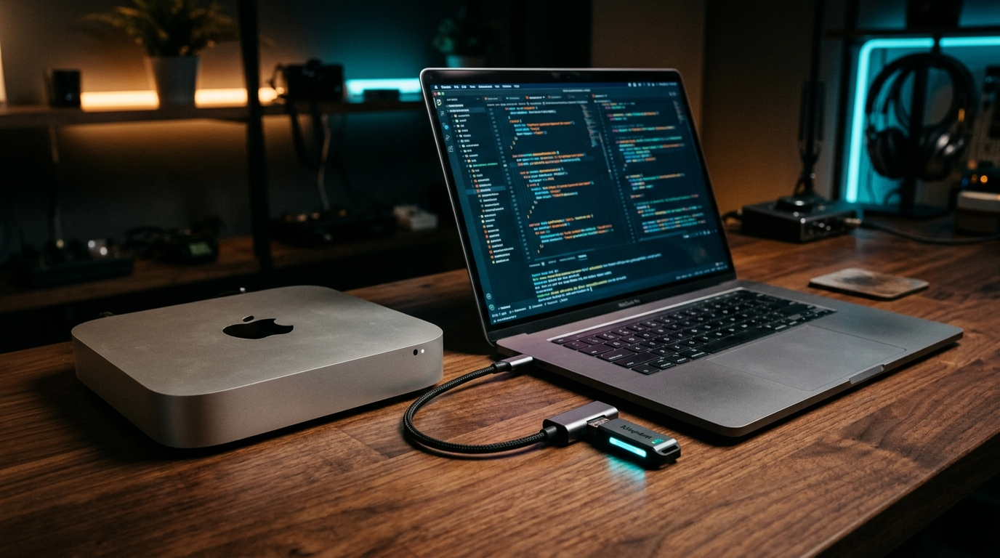
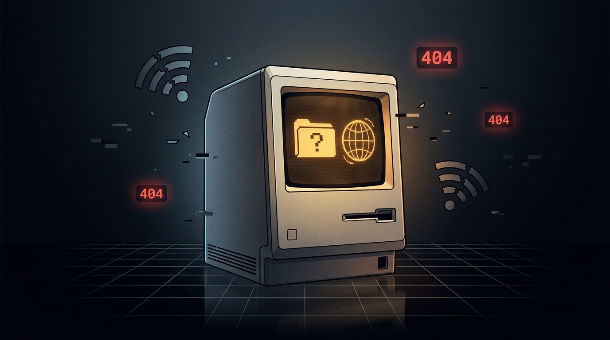
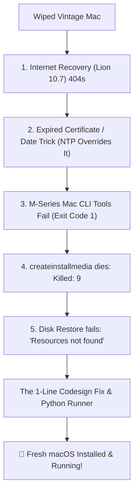
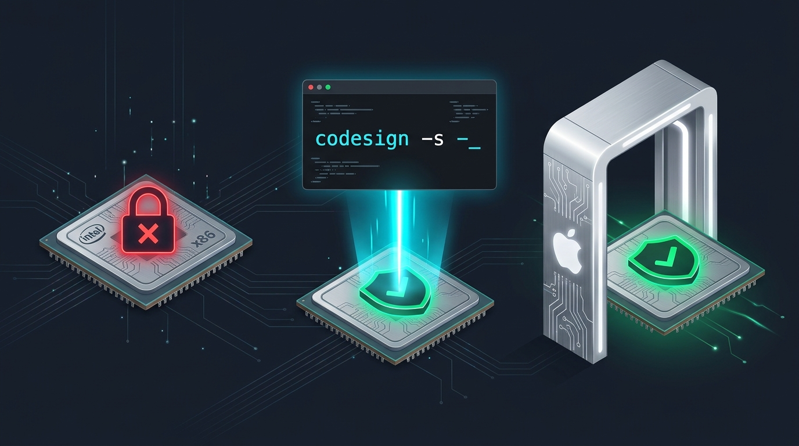
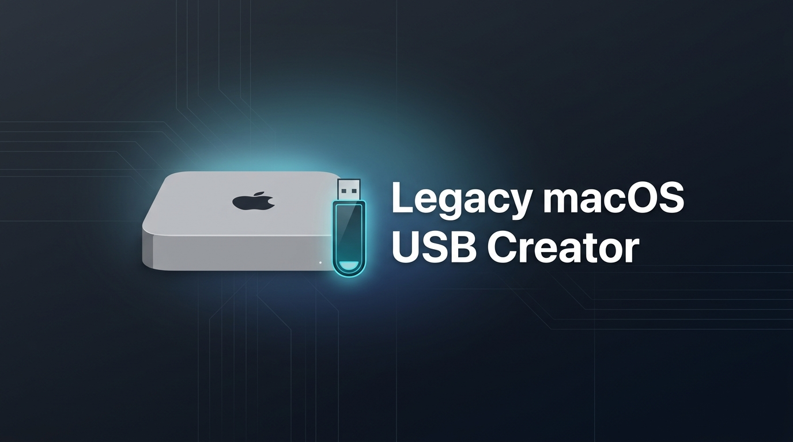

<!-- ============================================================== -->
<!-- ⚙️ MEDIUM STORY SETTINGS & SEO CHEAT SHEET (Copy into Medium Settings) -->
<!--
  STORY TITLE:
  Apple Left My 2011 Mac For Dead. A 1-Line Python Fix Brought It Back to Life.

  STORY SUBTITLE:
  Dead recovery servers, expired certificates, and the kernel security bug that almost sent a perfectly good Mac to the landfill.

  TOPICS / TAGS (Medium allows 5):
  1. Apple
  2. MacOS
  3. Retro Computing
  4. Tech Support
  5. Python

  SEO TITLE (Recommended < 60 chars):
  How to Reinstall Legacy macOS on Vintage Macs (AMFI Fix)

  SEO DESCRIPTION (Search snippet 140-156 chars):
  Can't reinstall macOS on an older Mac? How to bypass dead Internet Recovery and the Apple Silicon Killed: 9 crash to build a working bootable USB installer.

  CANONICAL LINK:
  https://github.com/srinivasa-dev/legacy-mac-usb-creator
-->
<!-- ============================================================== -->

# Apple Left My 2011 Mac For Dead. A 1-Line Python Fix Brought It Back to Life.

### Dead recovery servers, expired certificates, and the kernel security bug that almost sent a perfectly good Mac to the landfill.



> *An engineering breakdown of why modern Apple Silicon Macs reject legacy USB installers, why Internet Recovery is dead, and how to legally build a working bootable drive.*

---

### Quick Links & Info
- **Reading Time:** ~7 min read
- **Open-Source Tool:** [github.com/srinivasa-dev/legacy-mac-usb-creator](https://github.com/srinivasa-dev/legacy-mac-usb-creator)
- **One-Liner Fix:** Run this in Terminal on your modern Mac (with a 32GB+ USB plugged in as `MyVolume`):
  ```bash
  curl -fsSL https://raw.githubusercontent.com/srinivasa-dev/legacy-mac-usb-creator/main/run.sh | sudo bash
  ```

---

## ⚡ A Few Other Catchy Titles If You Prefer:
1. *I Wiped My Old Mac and Got Trapped in Recovery Hell. Here's How I Got Out.*
2. *Why Modern Macs Secretly Refuse to Build Legacy macOS USBs (And the 1-Line Fix)*
3. *Don’t Throw Away That Old Mac: How to Reinstall macOS in 2026 When Apple’s Servers Say No*

---

## The "Simple" Plan That Wasted My Entire Weekend

A few days ago, I pulled out an old **2011 Mac mini**. 

Honestly, these older unibody Intel Macs are still absolute beasts. They have upgradeable RAM, two internal drive bays, full-sized ports, and they pull almost zero power at idle. I wanted to wipe the old hard drive clean and put a fresh copy of **macOS High Sierra (10.13.6)** on it—its last officially supported version.

The plan sounded stupidly simple:
1. Boot into Recovery mode.
2. Erase the internal drive.
3. Click "Reinstall macOS".
4. Done in 20 minutes.

Yeah... that’s not what happened. 

Within 10 minutes, I was staring at a blinking question mark folder, completely locked out of the machine.



If you've tried reinstalling or updating an older Mac recently, you’ve probably hit this exact same wall. Apple has quietly let the infrastructure for older machines rot. 

Here is what actually happens when you try to reinstall macOS on vintage hardware today, why modern M-series Macs secretly sabotage your efforts to make a USB installer, and the single command that solves the whole mess.

---

## The Recovery Hell: 5 Things That Failed Before We Found the Fix

Before I figured out the real solution, I ran headfirst into every dead end the internet had to offer. 



---

### Dead End #1: The Phantom Internet Recovery

When an older Mac has a wiped drive, holding `Cmd + R` triggers **Internet Recovery**. You get a cute little spinning globe asking for your Wi-Fi password.


After waiting 10 minutes for it to download, it boots you into... **Mac OS X Lion (from 2011)**. 

You click *"Reinstall Mac OS X"*, accept the terms, hit Install, and immediately get slapped with:

> **"Can't download the additional components needed to install Mac OS X."**

Why? Because Apple completely shut down the old Lion recovery servers. On top of that, Lion's recovery environment uses **TLS 1.0**, an ancient security protocol that modern web servers won't even talk to anymore. You're asking a machine to download files from servers that literally no longer exist.

---

### Dead End #2: The Reddit "Date" Trick (That Gets Overridden Instantly)

Next, I did what everyone does: I searched Reddit and Apple Support forums. 

Dozens of posts said: *"Oh, Apple’s security certificates expired in 2019! Just open Terminal from the top menu and set the clock back to 2018 with `date -u 0101010118`!"*

So I did that. Guess what happened?
1. The moment you reconnect to Wi-Fi to download the OS, macOS's background clock daemon (`timed`) queries `time.apple.com` and **immediately sets the clock back to today**. Your certificate trick is wiped out before the installer even starts.
2. If you try to disable the time daemon, Terminal tells you: `Read-only file system`.

Internet Recovery is dead. There is zero way around it: **you have to build a bootable USB drive.**

---

### Dead End #3: Making the USB on a Modern Mac Fails (`Exit Code 1`)

So I grabbed my daily laptop—an Apple Silicon MacBook Pro (M-series)—and plugged in a 32 GB USB flash drive.

I tried downloading High Sierra:
- **Mac App Store:** Won't even let you click download. It just says: *“This version of macOS cannot be installed on this computer.”*
- **Terminal tools like `mist`:** I used `mist-cli` to pull the High Sierra packages directly from Apple’s servers. The 5.7 GB download finished with green checkmarks. But the second it tried to build the installer app, it crashed with:

```text
Creating image '/private/tmp/com.ninxsoft.mist/041-91758/041-91758.dmg'...
[FAILED] Invalid Exit Status Code: '1'
```

Why? Because modern macOS uses `/usr/sbin/installer` to assemble downloaded packages. When that tool sees an ARM64 Apple Silicon chip, it rejects High Sierra’s 2017 Intel distribution scripts and dies.

---

### Dead End #4: The Mysterious Murder of `createinstallmedia` (`Killed: 9`)

At this point, I had all 5.7 GB of raw files in my temporary folder. I extracted `Install macOS High Sierra.app` manually.

Inside the app is Apple’s official USB-creation tool: `createinstallmedia`.

I opened Terminal and ran Apple's official command under Rosetta 2:

```bash
sudo arch -x86_64 "/Applications/Install macOS High Sierra.app/Contents/Resources/createinstallmedia" \
  --volume /Volumes/MyVolume --nointeraction
```

I pressed Enter. No error message. No warning. Just this:

```text
zsh: killed: 9  arch -x86_64 ...
```

Exit status: **137 (`SIGKILL`)**.


The macOS kernel literally assassinated Apple's own tool before it could even run a single line of code!

---

### Dead End #5: The Naive Disk Restore & "Resources Not Found"

Out of sheer frustration, I thought: *"Fine, I'll just clone the BaseSystem.dmg image straight onto the USB thumb drive using Disk Utility / `asr`."*

It worked! The USB drive booted up on the 2011 Mac mini! The installer opened!

I clicked Install, waited 2 minutes, and then:

> **"The installer resources were not found."**

And when the Mac restarted? A completely black screen with blinking white text:
```text
Missing operating system. No bootable device -- insert boot disk and press any key
```

Turns out, `BaseSystem.dmg` only has the recovery interface—it doesn't have the actual 4.7 GB macOS payload (`InstallESD.dmg`). Apple's `createinstallmedia` tool does specific magic under the hood (partition layout, boot helpers, catalog junctions) that you cannot fake with a simple disk clone.

We *had* to make `createinstallmedia` run.

---

## The Breakthrough: How We Cracked the Code

At this point, after hours of staring at opaque error codes, I paired with my AI coding assistant (**Antigravity**) to treat this like a reverse-engineering challenge rather than just blindly guessing terminal commands.

Together, we dug into the `Killed: 9` exit code, traced it to macOS security subsystems under Rosetta 2, and realized that re-signing the binary with `codesign -s - --force` would satisfy the kernel. From there, the AI helped me automate the entire image extraction, plist patching, and drive creation into a clean Python script so nobody else has to do this manually.

Here is the exact technical reason why it happened:

Why was Apple Silicon killing `createinstallmedia` with `Killed: 9`?



### The Culprit: AMFI (Apple Mobile File Integrity)
When Apple built Apple Silicon Macs, they locked down macOS security big time. Under Rosetta 2 (the translation layer that runs Intel apps on M-series chips), every single Intel binary must pass strict **Apple Mobile File Integrity (AMFI)** checks.

The `createinstallmedia` tool inside High Sierra was compiled back in **2017**. Its cryptographic signature uses obsolete hashing algorithms that modern AMFI straight-up rejects.

The moment Rosetta tries to load the binary into memory, the kernel says: *"Unrecognized signature format. Kill it."* And fires an instant `SIGKILL`.

### The 1-Line Fix: Re-Sign It
You don't have to disable SIP. You don't have to reboot into Recovery on your MacBook.

All you have to do is tell Apple’s built-in `codesign` tool to strip off the stale 2017 signature and slap on a fresh, local ad-hoc signature:

```bash
codesign -s - --force "/Applications/Install macOS High Sierra.app/Contents/Resources/createinstallmedia"
```

- `-s -`: Sign it with an ad-hoc signature on your own machine.
- `--force`: Overwrite the stale signature.

That is literally it. The second you run that command, AMFI is happy. **Rosetta 2 runs `createinstallmedia` instantly without crashing!**

---

## The Fast Track: How to Do This in 3 Minutes

I didn't want anyone else to have to spend a weekend copying files between mounted disk images and patching XML plists. 

So I put the entire fix into an open-source tool on GitHub:

[](https://github.com/srinivasa-dev/legacy-mac-usb-creator)

👉 **GitHub Repository:** [github.com/srinivasa-dev/legacy-mac-usb-creator](https://github.com/srinivasa-dev/legacy-mac-usb-creator)

### You Don't Even Have to Clone It — Just Run This 1-Liner:

1. Plug a USB flash drive (32 GB+) into your modern Mac.
2. Open **Disk Utility**, click **Erase**, and format it as:
   - **Name:** `MyVolume`
   - **Format:** `Mac OS Extended (Journaled)`
   - **Scheme:** `GUID Partition Map`
3. Open Terminal and paste this command:

```bash
curl -fsSL https://raw.githubusercontent.com/srinivasa-dev/legacy-mac-usb-creator/main/run.sh | sudo bash
```

### What It Does For You Automatically:
- Checks your macOS environment and makes sure Rosetta 2 is ready.
- Unpacks the genuine Apple disk images.
- Copies the `InstallESD.dmg` system payload into `SharedSupport`.
- Patches `InstallInfo.plist` so the installer knows where to find the files.
- **Applies the `codesign` fix** so Apple Silicon won't kill the binary.
- Runs Apple’s official `createinstallmedia` tool onto your USB drive.

In about **3 minutes**, your USB drive is done, blessed, and ready to boot.

---

## Booting and Installing on the Old Mac

Now you can finally revive the machine:


1. Unplug the USB drive from your modern Mac and plug it into the older Mac.
2. Connect your display, keyboard, and mouse.
3. Turn on the Mac while holding down the **`Option` (Alt)** key.
4. You'll hear the startup chime, and the boot menu will appear. Click the orange **"Install macOS High Sierra"** icon.
5. Once Recovery opens:
   - Open **Disk Utility**.
   - Select the internal drive, click **Erase**, and format it as `Mac OS Extended (Journaled)` with `GUID Partition Map` (or `APFS` if you're using an internal SSD).
   - Close Disk Utility.
6. Click **Install macOS**, accept the terms, choose your clean drive, and hit Install.

Zero certificate errors. Zero 404s. In about 15 minutes, the Mac booted straight into the clean, official macOS setup screen!


---

## Wait, Is This All Legal?

Yes, 100%. Everything here is completely clean and follows Apple's EULA:

1. **Genuine Apple Hardware:** We are installing macOS on legitimate, Apple-branded hardware (as required by Apple's license agreement).
2. **Official Apple Servers:** The installer packages come directly from Apple's public Content Delivery Network (`swcdn.apple.com`). No sketchy torrents, no modified hackintosh images, no piracy.
3. **Official Apple Tools:** `codesign` is a built-in developer tool Apple gives us. Using it to re-sign a binary for local execution doesn't violate DRM or copyright law.
4. **Open-Source Code:** The GitHub repo only shares the **orchestration shell and Python script** under the [Apache License 2.0](https://github.com/srinivasa-dev/legacy-mac-usb-creator/blob/main/LICENSE). No proprietary Apple binaries are hosted or distributed.

---

## Don't Let Good Hardware Go to Waste

It's crazy that a perfectly good aluminum computer can almost get sent to the recycling center just because cloud recovery servers got decommissioned and modern Macs changed architectures.

If you have an older Mac mini, MacBook, or iMac sitting in a closet gathering dust, grab a cheap USB thumb drive and give it another run. These machines still have plenty of life left in them.

---

### Links & Code
- **Repository:** [github.com/srinivasa-dev/legacy-mac-usb-creator](https://github.com/srinivasa-dev/legacy-mac-usb-creator)
- **1-Liner:**
  ```bash
  curl -fsSL https://raw.githubusercontent.com/srinivasa-dev/legacy-mac-usb-creator/main/run.sh | sudo bash
  ```
- Drop a star on GitHub if this saved your weekend, and happy tinkering!
