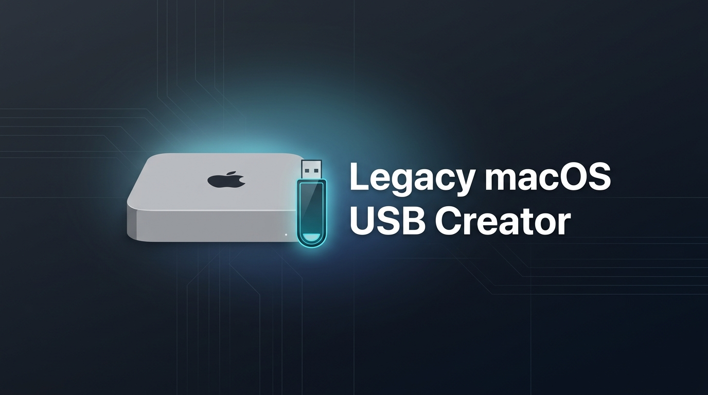

# Legacy macOS USB Creator 🍎💾



[](https://opensource.org/licenses/Apache-2.0)
[](https://apple.com)
[](https://python.org)
[](#-zero-friction-quickstart)
[](https://srinivasa-yadav.medium.com/apple-left-my-2011-mac-for-dead-a-1-line-python-fix-brought-it-back-to-life-b99ce91442c7)

A zero-friction, automated utility designed to create genuine, bootable legacy macOS USB installers (e.g. High Sierra 10.13) on modern Apple Silicon (M1/M2/M3/M4) and Intel Macs without hitting AMFI `Killed: 9` crashes or package distribution blocks.

---

## ⚡ Zero-Friction Quickstart

Insert a 32 GB+ USB drive, format it as `MyVolume` (Mac OS Extended Journaled, GUID Partition Map), and run this single command in your Mac Terminal:

```bash
curl -fsSL https://raw.githubusercontent.com/srinivasa-dev/legacy-mac-usb-creator/main/run.sh | sudo bash
```

No cloning, no manual dependencies, and no manual package patching required.

---

## 🛑 The Problem: Why Reviving Older Macs is Broken

When you wipe an older Intel Mac (such as a 2010–2012 Mac mini, vintage MacBook, or iMac), you immediately run into three major roadblocks:

1. **Dead Internet Recovery:** Apple has retired older recovery catalogs (e.g. OS X Lion). The recovery system relies on deprecated TLS 1.0/1.1 protocols that modern Apple servers reject, leaving you stuck with a flashing question mark folder.
2. **Apple Silicon Incompatibility:** Modern Macs running macOS Big Sur or later block legacy installation packages with `Invalid Exit Status Code: 1` when `/usr/sbin/installer` detects modern hardware.
3. **The Rosetta AMFI Trap (`Killed: 9`):** When you attempt to run Apple's official legacy `createinstallmedia` binary on an Apple Silicon Mac under Rosetta 2, macOS's **Apple Mobile File Integrity (AMFI)** immediately terminates the process with `SIGKILL` (exit code 137 / `Killed: 9`) because the 2017 code signature uses outdated cryptographic hashes.

---

## 💡 The Solution: How This Tool Works

```
 ┌───────────────────────────────────────────────────────────────┐
 │ 1. Validates downloaded authentic Apple CDN packages          │
 │ 2. Mounts BaseSystem.dmg & extracts Install macOS app         │
 │ 3. Populates Contents/SharedSupport with InstallESD.dmg       │
 │ 4. Patches InstallInfo.plist catalog mappings                 │
 │ 5. Applies ad-hoc codesign: codesign -s - --force             │
 │ 6. Invokes Apple's official createinstallmedia onto the USB  │
 └───────────────────────────────────────────────────────────────┘
```

By applying a local **ad-hoc code signature** (`codesign -s - --force`), AMFI is satisfied, allowing Rosetta 2 to execute Apple's official `createinstallmedia` binary natively on Apple Silicon.

---

## 🛠️ Step-by-Step Instructions

### Step 1: Prepare Your USB Thumb Drive
1. Insert a USB flash drive (32 GB or larger) into your modern Mac.
2. Open **Disk Utility**.
3. Select the USB drive and click **Erase**:
   - **Name:** `MyVolume`
   - **Format:** `Mac OS Extended (Journaled)`
   - **Scheme:** `GUID Partition Map`
4. Click **Erase**.

### Step 2: Download macOS High Sierra Packages
You can download the genuine packages directly from Apple's official Content Delivery Network using either `mist-cli` or `gibMacOS`:

```bash
# Using mist-cli
brew install mist-cli
sudo mist download installer "macOS High Sierra" --cache-downloads
```

### Step 3: Run the Creator
Execute the one-liner:
```bash
curl -fsSL https://raw.githubusercontent.com/srinivasa-dev/legacy-mac-usb-creator/main/run.sh | sudo bash
```

Alternatively, if you cloned this repository locally:
```bash
git clone https://github.com/srinivasa-dev/legacy-mac-usb-creator.git
cd legacy-mac-usb-creator
sudo bash run.sh
```

### Step 4: Boot and Install on Your Vintage Mac
1. Eject the USB drive and plug it into your vintage Mac.
2. Turn on the Mac while holding down the **`Option` (Alt)** key.
3. Select the orange/yellow **Install macOS High Sierra** icon.
4. In Recovery, open **Disk Utility**, erase the internal drive as `Mac OS Extended (Journaled)` with `GUID Partition Map`.
5. Run the installer. Your vintage Mac will be revived in ~15 minutes!

---

## ⚖️ Legal & EULA Compliance

This tool strictly adheres to Apple's software policies and copyright law:
- **Genuine Hardware Only:** Intended solely for installing macOS on Apple-branded hardware in accordance with Apple's macOS EULA.
- **Official CDN Streams:** Downloads occur directly between the user's computer and Apple's public Content Delivery Network (`swcdn.apple.com`).
- **No Piracy:** This repository distributes **zero proprietary Apple binaries or disk images**.
- **Sanctioned Developer Tools:** Uses Apple's built-in `codesign` developer utility for local execution.

---

## 📜 Disclaimer
Please see [DISCLAIMER.md](DISCLAIMER.md) for full terms and warranty limitations. This open-source tool is provided "AS IS" for hardware preservation purposes without warranties of any kind.

---

## 📄 License
This project is licensed under the [Apache License 2.0](LICENSE).
